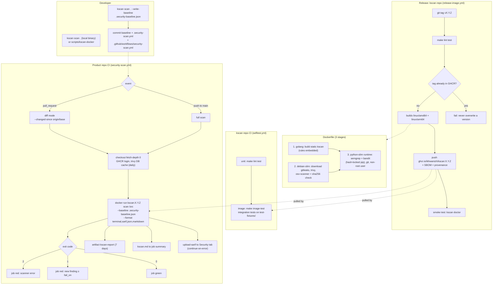

# Architecture

How kscan is released, how a product repo's CI uses it, and what happens inside one `kscan scan`.

## Release, CI and consumers

The image is built once per version tag and never rebuilt; product repos only pull it.

## Inside one scan

```mermaid
flowchart TD
    A["kscan scan repo + flags"] --> B["config.Load .security-scan.yml<br/>strict YAML + validation"]
    B -->|invalid| X2["exit 2"]
    B --> C["selectScanners<br/>--only/--skip, then config enable/disable, then all 7<br/>enable list = required"]
    C --> D["detect.Detect<br/>Go / Python / Rust / PHP / Node"]
    D --> E{"--changed-since ref?"}
    E -->|yes| G["gitdiff.Changed<br/>git diff --diff-filter=ACMR ref...HEAD"]
    E -->|no| H
    G --> H["scanner.RunAll<br/>parallel, per-scanner timeout, crash isolated"]

    H --> P1{"Applies to stack?"}
    P1 -->|no| SK["status: skipped"]
    P1 -->|yes| P2{"binary installed?"}
    P2 -->|"no, optional"| SK
    P2 -->|"no, required"| ER["status: error"]
    P2 -->|yes| P3["Run tool"]
    P3 -->|"crash / timeout"| ER
    P3 -->|"no changed targets"| SK
    P3 -->|success| OK["status: ok + findings"]

    subgraph TOOLS["Scanners (diff mode behavior)"]
        T1["gitleaks: secrets, --redact<br/>diff: only PR commits ref..HEAD"]
        T2["semgrep: SAST + custom kscan rules<br/>diff: only changed files"]
        T3["bandit: Python SAST<br/>diff: only changed .py"]
        T4["trivy: deps + misconfig<br/>always full"]
        T5["osv-scanner: deps<br/>always full"]
        T6["gosec, govulncheck: Go<br/>local only, not in image"]
    end
    P3 -.-> TOOLS

    OK --> N["parse tool output into Finding<br/>severity to critical/high/medium/low/info<br/>finalize: snippet, strip secret value, fingerprint"]
    N --> F1

    subgraph FILTER["filter.Apply (in order)"]
        F1["ignore_paths: drop"] --> F2["suppress (fingerprint or rule+path, reason): drop"]
        F2 --> F3["secret in docs/tests/templates: demote to info"]
        F3 --> F4["dedupe by fingerprint<br/>merge tools, keep higher severity"]
        F4 --> F5["min_severity: drop below"]
        F5 --> F6["sort: severity, file, line"]
    end

    F6 --> BL{"--baseline file exists?"}
    BL -->|yes| MK["mark New = fingerprint not in baseline"]
    BL -->|no| ALLN["every finding New"]
    MK --> WBQ
    ALLN --> WBQ{"--write-baseline?"}
    WBQ -->|"yes, any scanner error"| X2b["refuse, exit 2"]
    WBQ -->|"yes, all ok"| WBF["write baseline<br/>fingerprint, rule, file, severity only<br/>mark all existing"]
    WBQ -->|no| GATE
    WBF --> GATE

    subgraph GATEBOX["gate.Decide"]
        GATE{"any scanner status error?"}
        GATE -->|yes| C2["code 2 ERROR"]
        GATE -->|no| G2{"any New finding ≥ fail_on?"}
        G2 -->|yes| C1["code 1 FAIL"]
        G2 -->|"no, or fail_on none"| C0["code 0 PASS"]
    end

    C0 --> REP
    C1 --> REP
    C2 --> REP
    REP["write reports (mode 0600)<br/>terminal, kscan.sarif (baselineState), kscan.json,<br/>kscan.html, kscan.md"] --> OUT["process exit with gate code"]
    SK --> N
    ER --> N
```

- Skipped and errored scanners still reach the report, so every output lists every scanner's status.
- A scanner error is the only way to get exit 2 after a scan, and it wins over exit 1: an incomplete scan cannot count as a pass.
- `--write-baseline` refuses when any scanner errored, so a baseline never silently misses a tool's findings.
